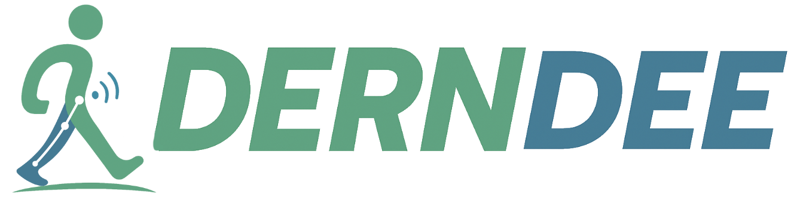
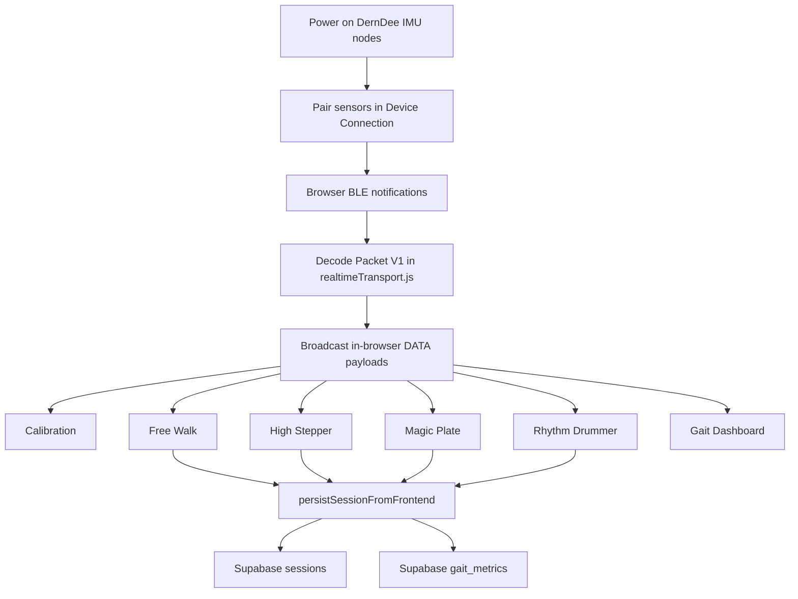

# DernDee

<p align="center">
  
</p>

<h3 align="center">Real-time gait rehabilitation platform with wearable IMUs, therapist-style feedback, and rehab game experiences</h3>

---

## Overview

DernDee is an end-to-end rehabilitation prototype for gait training and real-time movement analysis.
The current architecture uses wearable BLE IMU sensors, Browser BLE transport in the frontend, Supabase for cloud data, and React web apps for patient training and clinician review workflows.

Current repository documentation now lives in `docs/README.md` and the files linked from there.

The current repository centers around three main layers:

- **Wearable firmware** for ESP32 IMU nodes that stream raw motion data over BLE
- **Web application** for authentication, device pairing, calibration, free walking sessions, rehabilitation games, history screens, and doctor dashboard prototypes
- **Supabase data layer** for auth, profile data, session persistence, and review workflows

The system currently supports these main usage paths:

- **Free Walk therapy** with realtime gait metrics and avatar-style coaching
- **Rehab games** including High Stepper, Magic Plate, and Rhythm Drummer
- **Live gait dashboard** for signal inspection and parameter monitoring

> DernDee is a research and rehabilitation prototype. It is not a certified medical device and should not be used as a substitute for professional clinical judgment.

---

## Key Features

- **Realtime Browser BLE pipeline**
  - Pair multiple IMU sensors directly from the browser
  - Decode Packet V1 raw accel and gyro samples in `realtimeTransport.js`
  - Reuse the same in-browser realtime stream across Calibration, Free Walk, games, and the gait dashboard
  - Persist completed sessions to Supabase from the frontend

- **Patient web application**
  - Supabase authentication and patient profile bootstrapping
  - Device connection and calibration flow before therapy begins
  - Free Walk session summary, history screen, analysis screen, and telemedicine prototype

- **Rehabilitation game modes**
  - **High Stepper** for foot clearance and knee-lift training
  - **Magic Plate** for balance control using quaternion-derived tilt
  - **Rhythm Drummer** for cadence and timing practice against a target beat

- **Live dashboard tools**
  - Secondary gait dashboard entry served by Vite for signal-level monitoring
  - Can reuse the active Browser BLE session from the patient app

- **Doctor workflow prototype**
  - Doctor dashboard, patient detail, review screen, and chat UI
  - History and session review now read directly from Supabase

---

## Workflow



---

## Main Outputs

| Workflow | Input | Output |
| --- | --- | --- |
| Device Connection | Browser BLE pairing | Connected sensor slots and streaming status |
| Calibration | In-browser control flow | Calibration status and readiness gate |
| Free Walk | Raw IMU stream | Step count, cadence, step length, stride length, walking speed, clearance, avatar feedback |
| High Stepper | Raw IMU stream | Rep count, lift height progress, target-based training feedback |
| Magic Plate | Raw IMU stream | Yaw or tilt balance cursor, zone statistics, average deviation |
| Rhythm Drummer | Step timing against BPM target | Score, streak, cadence estimate, timing feedback |
| Gait Dashboard | Raw accel and gyro samples | Live charts, detected gait events, derived gait parameters |

---

## Repository Structure

```text
.
|-- README.md
|-- docs/
|   |-- README.md
|   |-- system-overview.md
|   |-- frontend-apps.md
|   |-- realtime-browser-ble.md
|   `-- supabase-cloud-data-layer.md
|-- DernDee_Web-app/
|   |-- package.json
|   |-- vite.config.js
|   |-- apps/
|   |   |-- patient/
|   |   `-- clinic/
|   |-- shared/
|   `-- public/
|-- Hardware/
`-- supabase/
    `-- migrations/
```

---

## Tech Stack

| Layer | Tools |
| --- | --- |
| Frontend | React, Vite, React Router, Tailwind CSS, Lucide React, Chart.js |
| Realtime Transport | Browser BLE, sessionStorage-backed transport manager |
| Gait Analytics | Frontend shared gait processing, realtime step detection, orientation tracking |
| Data Layer | Supabase Auth, Postgres, Storage, RLS |
| Firmware | ESP32, Arduino C++, BLE, ICM-20948 style IMU access |

---

## Quick Start

### 1. Clone the repository

```bash
git clone <repository-url>
cd DernDee_Robustness
```

### 2. Start the web application

```bash
cd DernDee_Web-app
npm install
npm run dev
```

The frontend runs at:

- `http://localhost:5174`

### 3. Open the application

- Patient app: `http://localhost:5174`
- Clinic app: `http://localhost:5174/clinic/`
- Gait dashboard: `http://localhost:5174/gait-dashboard`

### 4. Power on compatible IMU nodes

Use `Hardware/esp32_imu_node.ino` and keep BLE device names prefixed with `DernDee`.

### 5. Pair sensors from the browser

1. Open `Device Connection`
2. Click `Connect via BLE` for each required slot
3. Complete calibration and start therapy

---

## Local Development

### Frontend

```bash
cd DernDee_Web-app
npm install
npm run dev
```

Notes:

- Vite is configured to serve on port `5174`
- Supabase is used for auth, profile data, and session history
- Live sensor mode requires a browser that supports Web Bluetooth

### Firmware

Flash the current packet-compatible firmware:

```text
esp32_imu_node.ino
```

Current notes:

- The firmware streams a 22-byte Packet V1 payload with magic, version, sequence, timestamp, raw accel, raw gyro, and CRC8
- `esp32_IMU_Ver2.ino` is an older reference firmware and does not match the current browser decoder format directly

---

## Example User Journey

1. Power on the DernDee IMU nodes.
2. Start the React frontend from `DernDee_Web-app/`.
3. Open the app and sign in.
4. Pair sensors in Device Connection.
5. Complete calibration while standing still.
6. Start a Free Walk session or one of the rehab games.
7. Receive realtime metrics and therapist-style feedback.
8. Review saved sessions from history or clinic screens.

---

## Notes for Development and Deployment

- The active realtime pipeline now lives entirely in the frontend shared modules.
- Gait processing and game-specific control logic live primarily in the frontend shared modules.
- Patient history and session persistence center on Supabase.
- Deployment requires browsers and devices that support Web Bluetooth for live sensor mode.

---

## Project Status

Current repo status at a high level:

- Browser BLE realtime transport, frontend gait processing, and game input loops are implemented
- Patient-facing web flows for login, therapy selection, device pairing, calibration, and sessions are available
- Doctor and telemedicine experiences are present as prototypes and still need backend completion
- Older firmware files remain in the repository for reference

---

## License

This repository does not currently include a root license file.
Add an explicit license before public redistribution or open-source release.
