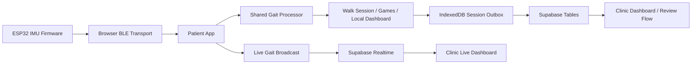

# DernDee


อัปเดตตามโค้ดและโครงสร้าง repository ปัจจุบัน ณ 2026-06-11

DernDee เป็น prototype ระบบฟื้นฟูการเดินแบบ realtime ที่รวม firmware IMU, Browser BLE transport, patient และ clinic web apps, shared gait analytics runtime, และ Supabase cloud data layer ไว้ใน repo เดียว

ถ้าเอกสารกับโค้ดขัดกัน ให้ยึดโค้ดใน repo เป็นหลัก

## TL;DR

- frontend หลักอยู่ใน `DernDee_Web-app/`
- ใช้ React 18 + Vite 4 + React Router 6
- build ปัจจุบันมี 2 HTML entry หลัก: patient app และ clinic app
- realtime transport หลักอยู่ใน browser ผ่าน Browser BLE
- doctor live dashboard ใช้ Supabase Realtime Broadcast เป็น relay ของ live data
- session persistence เป็น offline-first: queue ลง IndexedDB ก่อน แล้วค่อย sync ไป Supabase
- gait processing, dashboard runtime, auth, และ services ถูกแชร์ผ่าน `DernDee_Web-app/shared/`

## ภาพรวมสถาปัตย์ปัจจุบัน



ระบบปัจจุบันแบ่งเป็น 4 ชั้นหลัก

1. Firmware และ BLE packet source
   ESP32 IMU ส่ง raw accel/gyro ผ่าน BLE notifications
2. Browser realtime runtime
   frontend pair sensor, decode packet, broadcast `DATA` events, และรัน gait analysis ใน browser
3. Web applications
   patient app ใช้สำหรับ therapy, games, history, analysis, และ local dashboard
   clinic app ใช้สำหรับ doctor dashboard, review flow, และ live gait monitoring
4. Supabase data layer
   ใช้สำหรับ auth, profiles, patient presence, sessions, gait metrics, doctor-patient assignment, review workflow, และ live relay บางส่วน

## โครงสร้าง repository

```text
DernDee_Robustness/
├── README.md
├── DernDee_Web-app/
│   ├── README.md
│   ├── apps/
│   │   ├── patient/
│   │   └── clinic/
│   ├── public/
│   ├── shared/
│   ├── package.json
│   ├── vite.config.js
│   └── vercel.json
├── docs/
│   ├── README.md
│   ├── system-overview.md
│   ├── frontend-apps.md
│   ├── realtime-browser-ble.md
│   ├── supabase-cloud-data-layer.md
│   └── current-gait-detection-and-integration.md
├── Hardware/
│   ├── esp32_ICM20948_Ver2.ino
│   ├── esp32_IMU_Ver2.ino
│   └── esp32_imu_node.ino
└── supabase/
    └── migrations/
```

## พื้นผิวหลักของระบบ

### Patient app

patient app เปิดจาก root path `/` และมี route สำคัญดังนี้

| Route | Role |
| --- | --- |
| `/`, `/login`, `/register` | auth entry |
| `/home`, `/profile`, `/settings` | patient dashboard และ profile |
| `/therapy` | เลือก therapy mode |
| `/device-connection` | pair sensors ผ่าน Browser BLE |
| `/calibration` | calibration flow |
| `/walk-session` | Free Walk |
| `/walk-summary` | post-session summary |
| `/analysis-result` | latest analysis result |
| `/history` | session history ของ patient |
| `/gait-dashboard` | patient gait dashboard |
| `/game/clearance` | High Stepper |
| `/game/balance` | Magic Plate |
| `/game/rhythm` | Rhythm Drummer |
| `/game/stepping-stones` | Stepping Stones |

### Clinic app

clinic app เปิดจาก path `/clinic` และมี route สำคัญดังนี้

| Route | Role |
| --- | --- |
| `/clinic` | doctor dashboard |
| `/clinic/chat` | doctor chat prototype |
| `/clinic/patients/:patientId` | patient detail |
| `/clinic/patients/:patientId/analysis/:sessionId` | per-session review |
| `/clinic/live-gait/:patientId` | doctor live gait dashboard |

## Runtime flows หลัก

### 1. Auth และ profile bootstrap

- auth ใช้ Supabase client จาก `DernDee_Web-app/shared/supabase/client.js`
- state กลางของ auth/profile อยู่ที่ `DernDee_Web-app/shared/context/UserAuthContext.jsx`
- profile ถูก sync หรือ upsert ผ่าน `DernDee_Web-app/shared/services/profileService.js`
- patient browser จะ update `patient_presence` เป็น heartbeat ระหว่างออนไลน์

### 2. Device connection และ calibration

- patient pair sensor ที่ `/device-connection`
- runtime กลางอยู่ที่ `DernDee_Web-app/shared/gateway/realtimeTransport.js`
- sensor assignments ถูกเก็บใน `sessionStorage`
- calibration route ส่ง command `CALIBRATE` แล้วรอ `CALIBRATION_START` และ `CALIBRATION_DONE`
- route ถัดไป reuse stream เดิมได้ใน tab เดียวกัน

### 3. Therapy sessions และ games

- `free_walk` ใช้ `WalkSession.jsx` และ shared gait processor
- games หลักใช้ `usePersistedGatewaySession()` เพื่อจัดการ session lifecycle
- completed session ถูก normalize เป็น frontend session record
- ถ้า offline ระบบจะ queue ลง IndexedDB ก่อน แล้ว sync ตอนกลับมา online

### 4. Patient gait dashboard

- dashboard runtime กลางอยู่ที่ `DernDee_Web-app/shared/gait-dashboard/app.js`
- local dashboard อ่าน sample จาก Browser BLE transport โดยตรง
- รองรับ demo mode และ live mode
- analysis ใช้ worker-backed processor เพื่อหลบ UI jank

### 5. Doctor live dashboard

- patient app mount `PatientLiveGaitMirror` ระดับบนสุดเมื่อผู้ใช้เป็น patient
- mirror subscribe sample จาก transport กลาง
- sample ถูก batch แล้วส่งผ่าน Supabase Realtime ใน `DernDee_Web-app/shared/services/liveGaitBroadcast.js`
- doctor route `/clinic/live-gait/:patientId` subscribe channel เดียวกัน
- doctor dashboard ใช้ shared dashboard runtime ตัวเดียวกับฝั่ง patient แต่เปลี่ยน source เป็น remote broadcast

### 6. Clinic review workflow

- doctor login ผ่าน clinic app และต้องมี `profiles.role = 'doctor'`
- doctor dashboard อ่าน patient ที่ผูกผ่าน `doctor_patient_assignments`
- doctor เปิด patient detail เพื่อดู sessions ย้อนหลัง
- doctor review summary, notes, status และ export gait metrics CSV ได้ในบาง session type

## Quick Start

### Prerequisites

- Node.js 18 หรือใหม่กว่า
- npm
- Supabase project ที่ apply migrations แล้ว
- browser ที่รองรับ Web Bluetooth ถ้าต้องการใช้ sensor จริง

### 1. ติดตั้ง dependencies

```bash
cd DernDee_Web-app
npm install
```

### 2. ตั้งค่า environment variables

สร้างไฟล์ `.env` ใน `DernDee_Web-app/` อย่างน้อยด้วยค่าเหล่านี้

```bash
VITE_SUPABASE_URL=your_supabase_url
VITE_SUPABASE_ANON_KEY=your_supabase_anon_key
```

ค่าที่ใช้ในบาง flow เพิ่มเติม

- `VITE_SUPABASE_PROFILE_BUCKET`
- `VITE_SUPABASE_AUTH_REDIRECT_URL`
- `VITE_SUPABASE_SKIP_EMAIL_CONFIRMATION`
- `SUPABASE_SERVICE_ROLE_KEY`

หมายเหตุ:

- `SUPABASE_SERVICE_ROLE_KEY` ใช้เฉพาะ local signup helper ใน Vite dev server เท่านั้น
- ถ้าไม่มี `VITE_SUPABASE_URL` และ `VITE_SUPABASE_ANON_KEY` ระบบ auth และ data layer จะไม่ทำงาน

### 3. Apply Supabase migrations

ให้ apply migration ตามลำดับใน `supabase/migrations/`

1. `20260430000100_initial_cloud_data_layer.sql`
2. `20260430000200_enable_doctor_patient_linking.sql`
3. `20260430000300_add_session_details.sql`
4. `20260504000100_enable_patient_session_inserts.sql`
5. `20260504000200_set_session_source_default_to_frontend.sql`

### 4. รัน dev server

```bash
cd DernDee_Web-app
npm run dev
```

### 5. เปิดใช้งาน routes หลัก

- patient app: `http://localhost:5174/`
- clinic app: `http://localhost:5174/clinic`
- patient gait dashboard: `http://localhost:5174/gait-dashboard`

## Frontend scripts

รันใน `DernDee_Web-app/`

| Command | Purpose |
| --- | --- |
| `npm run dev` | start Vite dev server |
| `npm run build` | build production assets |
| `npm run lint` | lint `shared` และ `apps` |
| `npm run preview` | preview build output |

## Supabase data model ที่ใช้งานจริง

ตารางหลักในระบบปัจจุบันคือ

- `profiles`
- `doctor_patient_assignments`
- `patient_presence`
- `sessions`
- `gait_metrics`

### การ persist ตาม session type

| Session type | Persisted data |
| --- | --- |
| `free_walk` | `sessions` + `gait_metrics` |
| `stepping_stones` | `sessions` + `gait_metrics` + `sessions.details` |
| `high_stepper` | `sessions` + `sessions.details` |
| `magic_plate` | `sessions` + `sessions.details` |
| `rhythm_drummer` | `sessions` + `sessions.details` |

### สิ่งที่ไม่ถูกเก็บเป็น row realtime 100 Hz

- raw BLE packets
- `DATA` payloads ทุก frame
- doctor live batches จาก broadcast channel
- state ชั่วคราวของ calibration และ dashboard UI

หมายเหตุ: live viewer ของ doctor ใช้ Realtime relay ชั่วคราว ไม่ได้เก็บ sample 100 Hz ลงฐานข้อมูลแบบย้อนหลัง

## Session persistence แบบ offline-first

flow ปัจจุบันคือ

1. frontend สร้าง normalized session record
2. queue ลง IndexedDB ผ่าน `DernDee_Web-app/shared/services/sessionOutbox.js`
3. ถ้า online จะ sync ไป Supabase ทันที
4. ถ้า offline จะถูก flush โดย `DernDee_Web-app/shared/hooks/useOfflineSessionSync.js` เมื่อกลับมา online

ไฟล์สำคัญของ path นี้คือ

- `DernDee_Web-app/shared/services/sessionService.js`
- `DernDee_Web-app/shared/services/sessionOutbox.js`
- `DernDee_Web-app/shared/hooks/usePersistedGatewaySession.js`
- `DernDee_Web-app/shared/hooks/useOfflineSessionSync.js`

## Gait analytics runtime ปัจจุบัน

แกนวิเคราะห์ gait อยู่ใน `DernDee_Web-app/shared/gait/`

- `gaitProcessor.js` รวม cycle detection, integration และ output metrics
- `gaitEventDetector.js` หา HS, TO, MSV จาก shank angular velocity
- `velocityIntegrator.js` ทำ drift-corrected integration หา spatial metrics
- `sessionAnalyzer.js` สะสม per-cycle rows และ summary ระดับ session
- `feedbackAdvisor.js` ให้ heuristics สำหรับ in-session feedback
- `gaitProcessor.worker.js` รัน analysis นอก main thread เมื่อ browser รองรับ Worker

patient dashboard และ doctor live dashboard reuse runtime กลุ่มนี้ผ่าน `DernDee_Web-app/shared/gait-dashboard/app.js`

## Firmware และ packet contract ปัจจุบัน

frontend decoder ปัจจุบันรองรับ Packet V1 ขนาด 22 bytes แบบ little-endian

```text
[magic(2), version(1), seq(2), timestamp_us(4),
 ax(2), ay(2), az(2), gx(2), gy(2), gz(2), crc8(1)]
```

สรุป compatibility ตอนนี้

- `Hardware/esp32_IMU_Ver2.ino` ตรงกับ decoder ปัจจุบันใน frontend
- magic ที่ใช้คือ `0xAA55`
- packet มี sequence, timestamp, raw accel, raw gyro, และ CRC8
- `Hardware/esp32_imu_node.ino` ใช้ layout และ checksum คนละแบบ จึงควรถือเป็น reference หรือ firmware prototype คนละ generation

## Browser และ runtime requirements

- live sensor mode ต้องใช้ browser ที่รองรับ Web Bluetooth จริง
- การ pair ครั้งแรกต้องมี user gesture จาก UI
- การ reuse permission ระหว่างหน้าใน browser เดียวขึ้นกับ `navigator.bluetooth.getDevices()`
- PWA ช่วยเรื่อง offline app shell แต่ไม่ได้แทน Web Bluetooth support

## การ deploy ปัจจุบัน

ถ้า deploy บน Vercel ให้ตั้งค่าแบบนี้

- Root Directory: `DernDee_Web-app`
- Framework Preset: `Vite`
- Install Command: `npm install`
- Build Command: `npm run build`
- Output Directory: `dist`

ตัวแปรแวดล้อมที่ควรมีบน deployment target อย่างน้อย

- `VITE_SUPABASE_URL`
- `VITE_SUPABASE_ANON_KEY`
- `VITE_SUPABASE_AUTH_REDIRECT_URL` ถ้าต้องการ redirect URL แบบ explicit

หมายเหตุเชิงปฏิบัติการ

- โปรเจกต์นี้เปิดใช้ PWA และ service worker
- หลัง deploy อาจต้อง hard refresh หรือ unregister service worker ถ้ายังเห็น asset เก่า
- live sensor mode ยังต้องอาศัย browser/device ที่รองรับ Web Bluetooth จริง แม้จะติดตั้งเป็น PWA ได้

## Known caveats

- live sensor mode ใช้ได้เฉพาะ browser ที่รองรับ Web Bluetooth
- doctor live dashboard ใช้ Supabase Realtime quota เพิ่มจาก baseline ของ auth และ history queries
- production build ผ่าน แต่มี warning เรื่อง chunk size และ asset รูปภาพขนาดใหญ่
- package name ใน `DernDee_Web-app/package.json` ยังเป็น `react-firebase-auth` ซึ่งเป็นชื่อเดิม
- โปรเจกต์ยังไม่ได้ expose automated test suite เป็น script หลักใน frontend package

## แผนที่เอกสารใน repo

| File | Scope |
| --- | --- |
| `docs/README.md` | entry point ของชุดเอกสาร |
| `docs/system-overview.md` | ภาพรวมสถาปัตย์และ runtime flows |
| `docs/frontend-apps.md` | app boundaries, route map, shared layer |
| `docs/realtime-browser-ble.md` | Browser BLE runtime และ doctor live broadcast flow |
| `docs/supabase-cloud-data-layer.md` | schema, migrations, RLS, deployment checklist |
| `docs/current-gait-detection-and-integration.md` | gait event detection และ integration algorithm |
| `docs/sota-stroke-gait-analysis-prd.md` | product requirements, target architecture, gaps, และ roadmap สำหรับ SOTA stroke gait analysis |
| `DernDee_Web-app/README.md` | frontend package setup และ deployment notes |

## จุดเริ่มอ่านโค้ดสำหรับ developer

| What to inspect | Start here |
| --- | --- |
| Patient router | `DernDee_Web-app/apps/patient/src/main.jsx` |
| Clinic router | `DernDee_Web-app/apps/clinic/src/main.jsx` |
| Auth context | `DernDee_Web-app/shared/context/UserAuthContext.jsx` |
| Browser BLE transport | `DernDee_Web-app/shared/gateway/realtimeTransport.js` |
| Session persistence | `DernDee_Web-app/shared/services/sessionService.js` |
| Offline outbox | `DernDee_Web-app/shared/services/sessionOutbox.js` |
| Live gait relay | `DernDee_Web-app/shared/services/liveGaitBroadcast.js` |
| Shared gait runtime | `DernDee_Web-app/shared/gait/` |
| Shared dashboard runtime | `DernDee_Web-app/shared/gait-dashboard/` |
| Supabase schema | `supabase/migrations/` |
| Firmware packet producer | `Hardware/esp32_IMU_Ver2.ino` |

## Current validation snapshot

ตรวจจาก workspace นี้ ณ 2026-06-11

- `npm run build` ผ่านใน `DernDee_Web-app/`
- `npm run lint` ผ่านใน `DernDee_Web-app/`

## สรุปสำหรับคนเข้ามาใหม่

ถ้าต้องการเข้าใจโปรเจกต์นี้เร็วที่สุด ให้ไล่ตามลำดับนี้

1. อ่านไฟล์นี้ก่อนเพื่อรู้ภาพรวม repo และ runtime ปัจจุบัน
2. เปิด `docs/system-overview.md` และ `docs/frontend-apps.md`
3. ดู `DernDee_Web-app/apps/patient/src/main.jsx` และ `DernDee_Web-app/apps/clinic/src/main.jsx`
4. ดู `DernDee_Web-app/shared/gateway/realtimeTransport.js` และ `DernDee_Web-app/shared/services/sessionService.js`
5. ถ้าสนใจ gait analytics ให้ต่อที่ `DernDee_Web-app/shared/gait/` และ `docs/current-gait-detection-and-integration.md`
6. ถ้าต้องการดู target product direction และ roadmap เชิงผลิตภัณฑ์ ให้ต่อที่ `docs/sota-stroke-gait-analysis-prd.md`