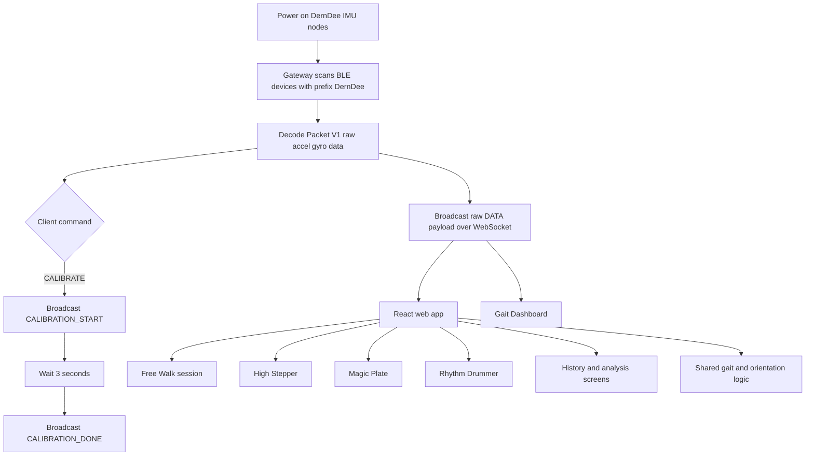

# DernDee

<p align="center">
  
</p>

<h3 align="center">Real-time gait rehabilitation platform with wearable IMUs, therapist-style feedback, and rehab game experiences</h3>

---

## Overview

DernDee is an end-to-end rehabilitation prototype for gait training and real-time movement analysis.
It combines wearable BLE IMU sensors, a Python BLE/WebSocket gateway, and a React web application for patient training, calibration, frontend-side gait analysis, and clinician-facing review workflows.

Current repository documentation now lives in `docs/README.md` and the files linked from there.

The current repository centers around three main layers:

- **Wearable firmware** for ESP32 IMU nodes that stream raw motion data over BLE
- **Realtime gateway** that decodes packets, streams raw IMU data over WebSocket, and persists session summaries
- **Web application** for authentication, calibration, free walking sessions, rehabilitation games, history screens, and doctor dashboard prototypes

The system currently supports these main usage paths:

- **Free Walk therapy** with realtime gait metrics and avatar-style coaching
- **Rehab games** including High Stepper, Magic Plate, and Rhythm Drummer
- **Live gait dashboard** for signal inspection and parameter monitoring

> DernDee is a research and rehabilitation prototype. It is not a certified medical device and should not be used as a substitute for professional clinical judgment.

---

## Key Features

- **Realtime raw streaming pipeline**
  - BLE scanning and multi-device streaming from IMU sensors whose names start with `DernDee`
  - Packet decoding and raw IMU rebroadcast over WebSocket
  - Session control and Supabase persistence through the gateway
  - Frontend-side gait analysis and game input loops shared between patient flows and clinic tools

- **Patient web application**
  - Supabase authentication and patient profile bootstrapping
  - Calibration flow over WebSocket before therapy begins
  - Free Walk session summary, history screen, analysis screen, and telemedicine prototype

- **Rehabilitation game modes**
  - **High Stepper** for foot clearance and knee-lift training
  - **Magic Plate** for balance control using quaternion-derived tilt
  - **Rhythm Drummer** for cadence and timing practice against a target beat

- **Live dashboard tools**
  - Secondary gait dashboard entry served by Vite for signal-level monitoring

- **Doctor workflow prototype**
  - Doctor dashboard, patient detail, review screen, and chat UI
  - Current implementation is partially connected to Firestore and still relies on mock data in several places

---

## Workflow



---

## Main Outputs

| Workflow | Input | Output |
| --- | --- | --- |
| Calibration | WebSocket control flow | Calibration status and readiness gate |
| Free Walk | Raw IMU stream | Step count, cadence, step length, stride length, walking speed, clearance, avatar feedback |
| High Stepper | Raw IMU stream | Rep count, lift height progress, target-based training feedback |
| Magic Plate | Raw IMU stream | Yaw/tilt balance cursor, zone statistics, average deviation |
| Rhythm Drummer | Step timing against BPM target | Score, streak, cadence estimate, timing feedback |
| Gait Dashboard | Raw accel and gyro samples | Live charts, detected gait events, derived gait parameters |

### Therapy Modes

| Mode | Purpose |
| --- | --- |
| Free Walk | General walking exercise with realtime coaching |
| High Stepper | Train foot clearance and reduce dragging |
| Magic Plate | Train balance using tilt control |
| Rhythm Drummer | Train rhythmic stepping and cadence consistency |
| Gait Dashboard | Inspect live sensor and derived gait signals |

---

## Repository Structure

```text
.
|-- README.md
|-- docs/
|   |-- README.md
|   |-- system-overview.md
|   |-- frontend-apps.md
|   |-- realtime-gateway.md
|   `-- supabase-cloud-data-layer.md
|-- DernDee_Web-app/
|   |-- package.json
|   |-- vite.config.js
|   |-- vercel.json
|   |-- apps/
|   |   |-- patient/
|   |   |   |-- index.html
|   |   |   `-- src/
|   |   |       `-- main.jsx
|   |   `-- clinic/
|   |       |-- index.html
|   |       |-- src/
|   |       |   |-- main.jsx
|   |       |   |-- components/
|   |       |   `-- data/
|   |       `-- gait-dashboard/
|   |           |-- index.html
|   |           |-- main.js
|   |           |-- data/
|   |           |-- dsp/
|   |           |-- styles/
|   |           `-- ui/
|   |-- public/
|   |-- shared/
|   `-- public/
|-- Hardware/
`-- gateway_v2/
    |-- main.py
    |-- connection.py
    |-- decoder.py
    |-- session_persistence.py
    `-- requirements.txt
```

---

## Tech Stack

| Layer | Tools |
| --- | --- |
| Frontend | React, Vite, React Router, Firebase, Tailwind CSS, Lucide React, Chart.js |
| Realtime Gateway | Python, asyncio, websockets, bleak, httpx |
| Gait Analytics | Frontend shared gait processing, realtime step detection, orientation tracking |
| Firmware | ESP32, Arduino C++, BLE, MPU9250-style IMU register access |
| Visualization | Custom React dashboards and browser-based rehab game UIs |

---

## Quick Start

### 1. Clone the repository

```bash
git clone <repository-url>
cd DernDee_Robustness
```

### 2. Start the realtime gateway

```bash
cd gateway_v2
python3 -m venv .venv
source .venv/bin/activate
pip install -r requirements.txt
python3 main.py
```

The gateway starts a WebSocket server at:

- `ws://0.0.0.0:8765`

### 3. Start the web application

```bash
cd DernDee_Web-app
npm install
npm run dev
```

The frontend runs at:

- `http://localhost:5174`

### 4. Open the application

- Patient app: `http://localhost:5174`
- Clinic app: `http://localhost:5174/clinic/`
- Gait dashboard: `http://localhost:5174/gait-dashboard`

### 5. Power on compatible IMU nodes

For the current gateway packet format, use `esp32_imu_node.ino` and keep BLE device names prefixed with `DernDee`.

---

## Local Development

### Frontend

```bash
cd DernDee_Web-app
npm install
npm run dev
```

Notes:

- Vite is configured to serve on port `5174`
- The app connects to `ws://${window.location.hostname}:8765`
- Supabase is used for auth, profile data, and session history

### Realtime Gateway

```bash
cd gateway_v2
python3 -m venv .venv
source .venv/bin/activate
pip install -r requirements.txt
python3 main.py
```

Installed Python dependencies are currently:

- `bleak`
- `httpx`
- `python-dotenv`
- `supabase`
- `websockets`

### Firmware

Flash the current packet-compatible firmware:

```text
esp32_imu_node.ino
```

Current notes:

- The firmware streams a 22-byte Packet V1 payload with magic, version, sequence, timestamp, raw accel, raw gyro, and CRC8
- `esp32_IMU_Ver2.ino` is an older reference firmware and does not match the current Python decoder format directly

---

## WebSocket Summary

### Server

- `ws://localhost:8765`

### Client Commands

| Message | Description |
| --- | --- |
| `CALIBRATE` | Start gateway-side calibration timer |
| `RESET` | Reset active gateway session state |
| `START_SESSION` | Open an in-memory session for persistence |
| `END_SESSION` | Persist summary/details/gait rows to Supabase |

### Server Events

| Event | Description |
| --- | --- |
| `CALIBRATION_START` | Calibration has begun |
| `CALIBRATION_DONE` | Calibration timer completed |
| `SYSTEM_RESET` | Runtime state has been reset |
| `SESSION_STARTED` | Session was opened in gateway memory |
| `SESSION_SAVED` | Session was persisted successfully |
| `SESSION_SAVE_FAILED` | Session persistence failed |
| `DATA` | Main realtime payload used by the web app and dashboard |

### Important `DATA` Payload Fields

| Field | Description |
| --- | --- |
| `name` | Sensor device name |
| `side` | Left or right side label |
| `sensor_mount` | Inferred mount such as `foot` or `shank` |
| `timestamp_ms` | Firmware timestamp in milliseconds |
| `raw_accel`, `raw_gyro` | Raw IMU samples from firmware |

---

## Example User Journey

1. Power on the DernDee IMU nodes.
2. Start `gateway_v2/main.py` on a BLE-capable machine.
3. Start the React frontend from `DernDee_Web-app/`.
4. Open the app and sign in.
5. Choose a therapy mode from the Therapy screen.
6. Complete calibration while standing still.
7. Start a Free Walk session or one of the rehab games.
8. Receive realtime metrics and therapist-style feedback.
9. Open the gait dashboard for live signal inspection if needed.

---

## Notes for Development and Deployment

- The active realtime pipeline in `gateway_v2/` is now a raw IMU bridge plus session persistence layer.
- Gait processing and game-specific control logic live primarily in the frontend shared modules.
- Doctor pages still include prototype surfaces, but patient history and session persistence now center on Supabase.
- Before public deployment, replace hardcoded local URLs and review Firebase project configuration carefully.

---

## Project Status

Current repo status at a high level:

- Realtime gateway, frontend gait processing, and game input loops are implemented
- Patient-facing web flows for login, therapy selection, calibration, and sessions are available
- Doctor and telemedicine experiences are present as prototypes and still need backend completion
- Older firmware files remain in the repository for reference

---

## License

This repository does not currently include a root license file.
Add an explicit license before public redistribution or open-source release.
