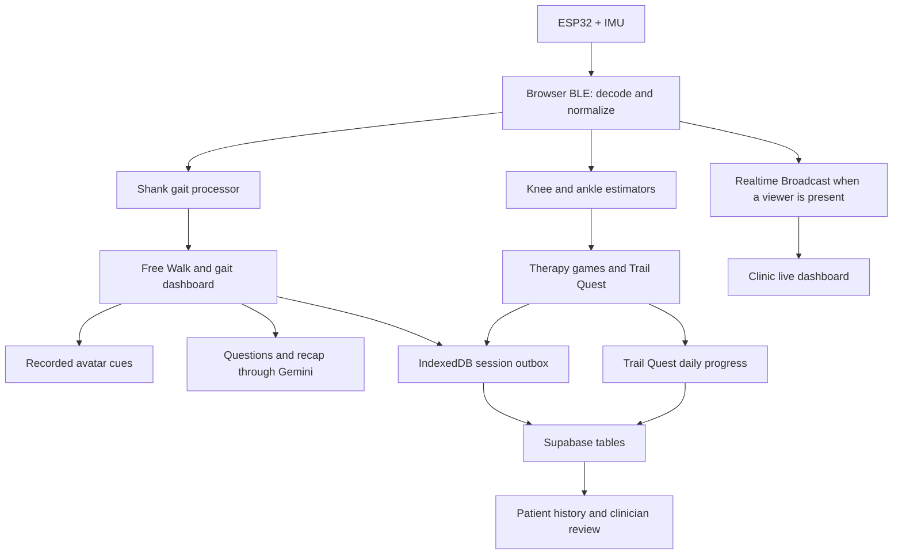

# ผลศึกษาโปรเจค StepDee

ตรวจจากโค้ดในเครื่องวันที่ 8 กันยายน 2026 ที่ commit `d15617db` โดยเริ่มจาก working tree ที่ไม่มีการแก้ไขค้างอยู่ รายงานนี้เพิ่มขึ้นจากการศึกษา ไม่ได้เปลี่ยนพฤติกรรมแอปหรือฐานข้อมูล

**ข้อสรุป:** StepDee เป็นต้นแบบระบบฝึกและติดตามการเดินที่มีการเชื่อมต่อครบหลายส่วนแล้ว ทั้งเซนเซอร์จริง เกมฝึก การวิเคราะห์ในเบราว์เซอร์ ประวัติผู้ป่วย หน้าคลินิก แชท และโค้ชเสียง แต่หลักฐานใน repository ยังไม่เพียงพอสำหรับสรุปความแม่นยำทางคลินิก และมีประเด็นด้านสิทธิ์ข้อมูลกับความถูกต้องของการบันทึกที่ควรจัดการก่อนขยายการใช้งาน

## 1. ขอบเขตการศึกษาและหลักฐาน

- สำรวจโครงสร้างและประวัติการเปลี่ยนแปลง อ่านเอกสารภาพรวม PRD และโค้ดตามเส้นทางหลักตั้งแต่ firmware ไปถึงหน้าคลินิก
- อ่านรายละเอียด transport, calibration, gait processing, session persistence, realtime broadcast, auth, database policies, AI coach และ Trail Quest
- repository มีไฟล์ที่ติดตามด้วย Git ในกลุ่ม JS/JSX/TS/TSX/Arduino/SQL รวม 138 ไฟล์ ประมาณ 37,031 บรรทัด และ migration 11 ไฟล์ ตัวเลขนี้ไม่รวม CSS, รูปภาพ, วิดีโอ และ dependencies
- รัน production build และ lint ที่มีอยู่จริงใน package
- ทดสอบ packet decoder, calibration และ gait processor ด้วยข้อมูลสังเคราะห์ และจำลองความล้มเหลวระหว่างบันทึกเซสชันด้วยบริการฐานข้อมูลจำลอง
- ไม่ได้รันกับ IMU จริง ไม่ได้ทดสอบบัญชีผู้ป่วย/แพทย์จริง ไม่ได้เรียก Gemini จริง และไม่ได้ตรวจว่าฐานข้อมูลที่ deploy มี policy เพิ่มเติมนอก repo หรือไม่

คำว่า “พบจากโค้ด” ในรายงานหมายถึงพฤติกรรมของ implementation ที่อ่าน ส่วน “ยืนยันด้วยการจำลอง” หมายถึงการทดสอบในเครื่อง ไม่ใช่ผลจากระบบ production

## 2. ตัวผลิตภัณฑ์และโครงสร้าง

ชื่อที่ผู้ใช้เห็นคือ **StepDee** แต่ชื่อโฟลเดอร์ BLE devices และ storage keys หลายส่วนยังใช้ `DernDee` ชื่อ package `react-firebase-auth` เป็นชื่อเก่า ปัจจุบัน auth ใช้ Supabase

| ส่วน | หน้าที่ | ตำแหน่งหลัก |
| --- | --- | --- |
| Firmware | อ่าน accelerometer/gyroscope แล้วส่ง BLE notifications | `Hardware/` |
| Patient app | เข้าระบบ เชื่อมเซนเซอร์ ฝึกเดิน เล่นเกม ดูประวัติและคุยกับแพทย์ | `DernDee_Web-app/apps/patient/` |
| Clinic app | ดูผู้ป่วยที่ผูกไว้ อ่านผลเซสชัน ตรวจผล ดูกราฟสด และแชท | `DernDee_Web-app/apps/clinic/` |
| Shared runtime | BLE, algorithms, auth, persistence, dashboard, audio และ AI client | `DernDee_Web-app/shared/` |
| Server endpoints | proxy คำขอโค้ชจากเว็บไป Supabase Edge Functions | `DernDee_Web-app/api/` |
| Cloud definitions | schema, RLS และ Gemini Edge Functions | `supabase/` |
| Product/research docs | สถาปัตยกรรม อัลกอริทึม เป้าหมายวิจัย และร่างแบบสอบถาม | `docs/` |

Frontend ใช้ React 18, React Router 6, Vite 4, Tailwind CSS, Chart.js, Supabase JS และ Google GenAI SDK โค้ดเกม Trail Quest ใช้ TypeScript ร่วมกับ JSX/JavaScript ของระบบเดิม

มี HTML entry สองตัว คือ patient และ clinic อยู่ใน package เดียวกัน โดย `/clinic` ใช้ router basename ของตัวเอง ไม่ได้เป็น backend แยกอีกระบบ ชื่อ `gateway` ที่ยังพบในโค้ดหมายถึงชั้นเชื่อมข้อมูลเดิม ปัจจุบันเส้นทางเซนเซอร์หลักทำงานใน browser โดยตรง



เกมทั่วไปใช้ session outbox ส่วน Trail Quest มีเส้นทางบันทึกคะแนนรายวันของตัวเอง ไม่ควรตีความว่าทุกเกมใช้ความทนทานต่อ offline แบบเดียวกัน

## 3. เส้นทางการใช้งาน

### ผู้ป่วย

1. สมัคร/เข้าสู่ระบบด้วย Supabase มี email confirmation/OTP, Google OAuth และ reset password
2. เข้า Home, Profile หรือ Settings แล้วเลือกฝึกจาก Therapy
3. เชื่อมอุปกรณ์ใน `/device-connection` และกำหนดตำแหน่งตามชื่ออุปกรณ์
4. Free Walk ใช้ `/walk-session` มีภาพสอนติดเซนเซอร์ การแตะเปิดเสียง และหน้าตั้งศูนย์ขณะยืนนิ่ง 3 วินาทีใน flow ของตัวเอง
5. ระหว่างเดิน แสดงระยะก้าว cadence และความเร็ว พร้อมอวตาร คำแนะนำ และปุ่มถามโค้ช
6. จบการเดินไป `/walk-summary` และบันทึกเซสชันเพื่อใช้ใน History/Clinic

ยังมี `/calibration` เป็นหน้าปรับตั้งแยก แต่ไม่ใช่เงื่อนไขว่าทุก flow ปัจจุบันต้องผ่านหน้านี้ก่อนเสมอ `/free-walk` redirect ไป `/walk-session`; `/analysis-result` เป็นตัว redirect ไปหน้าสรุป

### กิจกรรมฝึก

| กิจกรรม | รูปแบบของ implementation |
| --- | --- |
| Free Walk | วิเคราะห์การเดินจากหน้าแข้งอย่างน้อยหนึ่งข้าง รองรับสองข้าง |
| High Stepper | ฝึกยกขา/ความสูงการยกและเก็บรายละเอียดเกม |
| Magic Plate | เกมควบคุมการทรงตัวและการอยู่ในเป้าหมาย |
| Rhythm Drummer | เกมจังหวะการก้าว |
| Stepping Stones | ผ่านเป้าระยะก้าวแล้วตรวจช่วงลงเท้านิ่งก่อนนับสำเร็จ |
| Knee Flexion Quest | ใช้คู่ต้นขา–หน้าแข้งสำหรับมุมเข่า |
| Trail Quest | เกม Canvas หลายบท ใช้มุมข้อเท้าหรือเข่าควบคุมกิจกรรม |

Trail Quest อยู่ที่ `/game/trail` หรือ `/map` และเข้าเกมผ่าน `/play` มี 4 บท บทละ 3 ด่าน ได้แก่ Sky Duck, Boost Dash, Cliff Hopper และ Wild Trail

- Sky Duck ใช้ dorsiflexion จากคู่หน้าแข้ง–หลังเท้า
- Boost Dash ใช้ plantarflexion จากคู่เดียวกัน
- Cliff Hopper ใช้มุมเข่าจากคู่ต้นขา–หน้าแข้ง แม้ identifier ภายในจะชื่อ `hip-flexor`
- Wild Trail เลือกกิจกรรมตามชุดเซนเซอร์ที่มี
- มีทางเลือก `input=touch` สำหรับการควบคุมแบบแตะ จึงไม่ควรถือว่าคะแนนเกมทุกคะแนนเป็นข้อมูลที่เกิดจากเซนเซอร์โดยอัตโนมัติ
- คะแนนและการปลดล็อกเป็นรายวันตามเขตเวลา Asia/Bangkok

### คลินิก

แพทย์เข้า `/clinic` เพื่อดูรายชื่อผู้ป่วย เพิ่มความสัมพันธ์ด้วย patient UUID ดูรายละเอียดและประวัติ ตรวจผลรายเซสชัน เขียน review notes และปรับสถานะ `pending`, `approved`, `needs_attention` ได้ มี export gait metrics เป็น CSV

หน้ากราฟสดอยู่ที่ `/clinic/live-gait/:patientId` ใช้ dashboard runtime เดียวกับผู้ป่วยแต่รับข้อมูลผ่าน Broadcast ส่วน Telemedicine ปัจจุบันเป็นแชทข้อความและแนบผลวิเคราะห์ ไม่พบระบบ video call/WebRTC ที่ทำงานครบในเส้นทางนี้

## 4. Hardware และ BLE

Firmware มีสอง implementation: MPU9250 และ ICM-20948 โดย ICM ใช้ accel/gyro 6 แกน แม้ตัวชิปจะมีความสามารถอื่นด้วย ส่ง raw int16 ที่เป้าหมาย 100 Hz ผ่าน FreeRTOS producer/consumer tasks และ ring buffer 12 packets

Packet V1 ขนาด 22 bytes แบบ little-endian:

```text
magic(2) + version(1) + seq(2) + timestamp_us(4)
+ ax/ay/az(6) + gx/gy/gz(6) + crc8(1)
```

Decoder ตรวจขนาด, magic `0xAA55` และ CRC8 แล้วส่ง `DATA` event ภายใน browser ตัวกลางมี API หน้าตาคล้าย WebSocket เพื่อให้หน้าต่าง ๆ reuse วิธี subscribe เดิมได้ แต่ไม่มี websocket gateway ภายนอกใน sensor path นี้

**ตำแหน่งที่มีในโค้ดปัจจุบันคือ 6 slots:** LEFT/RIGHT_THIGH, LEFT/RIGHT_SHANK และ LEFT/RIGHT_FOOT เอกสารเก่าที่บอก 5 slots รวม pelvis/chest ไม่ตรงกับรายการที่เชื่อมได้ในปัจจุบัน

ชื่อ BLE ที่ขึ้นต้น `DernDee` ยังเป็นส่วนของสัญญาการเชื่อมต่อ การเปลี่ยนชื่อแบรนด์บนเว็บไม่ทำให้ firmware เปลี่ยนชื่อเอง โดย firmware ทั้งสองไฟล์ใน repo ตั้งค่าเริ่มต้นเป็น `DernDee_R_Foot` จึงต้องตั้งชื่อให้ตรงตำแหน่งก่อนแฟลชอุปกรณ์แต่ละตัว ระบบสามารถเลือก slot จากชื่ออุปกรณ์เหนือ slot ที่ผู้ใช้กดมาได้

การจำ BLE assignments ใช้ sessionStorage; การ reuse permission ใช้ `navigator.bluetooth.getDevices()` เมื่อ browser มีให้ คำสั่ง `CALIBRATE`, `START_SESSION`, `END_SESSION` ที่ transport รับเป็น control ภายใน browser ไม่ใช่คำสั่งส่งกลับ firmware และ `SESSION_SAVED` ที่ transport แจ้งมี `local_only: true` ไม่ใช่หลักฐานว่า Supabase บันทึกสำเร็จแล้ว

## 5. อัลกอริทึมการเดินและมุมข้อต่อ

มี pipeline สองกลุ่มที่ควรแยกให้ชัด:

**GaitProcessor สำหรับการเดิน:** ใช้ gyro แกน x ร่วมกับ accelerometer เพื่อหา shank angle ด้วย Kalman filter แล้วตรวจ HS/TO/MSV วิเคราะห์เวลาและประมาณระยะทาง ไม่ใช่ CSAV 7-phase ตามเป้าหมายใน PRD

**OrientationTracker และ joint estimators สำหรับเกม:** มี quaternion fusion แบบ Madgwick IMU แล้วหาความสัมพันธ์ของแนวแรงโน้มถ่วง/มุมจากเซนเซอร์สองตัว ใช้กับ KneeAngleEstimator และ AnkleAngleEstimator จึงมี quaternion path แล้วในบางส่วน แต่ยังไม่ใช่ pipeline gait analysis กลางทั้งระบบ

| ค่า runtime | โค้ดปัจจุบัน |
| --- | --- |
| อัตราที่ algorithm สมมติ | 100 Hz |
| Buffer วิเคราะห์ | 1,200 samples หรือ 12 วินาทีที่ 100 Hz |
| เริ่มวิเคราะห์ | อย่างน้อย 300 samples |
| รอบเรียก analysis หลัก | ทุก 400 ms |
| เซนเซอร์ไม่มีข้อมูลใหม่ | ตัวเลือก sensor หลักใช้ threshold 2,500 ms |
| HS-to-HS cycle ใน patient processor | ช่วง 1.0–4.0 วินาที |
| HS prominence ของ patient processor | 45; ต่างจาก default ของ detector ที่ 80 |
| Adaptive HS threshold floor | 12 deg/s ใน patient processor |
| ระยะก้าวที่ส่งออก | จำกัด 0.15–0.80 เมตร |
| Clearance ที่ส่งออก | จำกัด 0–0.30 เมตร |

Calibration เก็บข้อมูลยืนนิ่ง 3 วินาที ต้องมีอย่างน้อย 250 samples ตรวจความแปรปรวน gyro และขนาดแรงโน้มถ่วง แล้วคำนวณ gyro bias มีการเก็บความยาวหน้าแข้ง แต่ใน spatial integration หลักปัจจุบันค่านี้ยังไม่ได้เป็นตัวคูณระยะทาง

Spatial metrics มาจากการหมุน acceleration บนระนาบ y/z ลบแรงโน้มถ่วง integrate เป็นความเร็ว ลบ linear drift ที่หัว/ท้ายช่วง แล้ว integrate เป็น displacement ใช้ dt คงที่ 0.01 วินาที ขณะที่ Kalman ใช้ช่วงเวลาระหว่าง samples ได้ ดังนั้นผลกระทบจาก packet หายหรืออัตราส่งไม่สม่ำเสมอยังต้องทดสอบโดยเฉพาะ

เมื่อหา TO ไม่ได้ จะใช้ stance ratio ที่เคยวัดได้ภายในรอบตรวจจับ หรือคงค่า temporal เป็น null พร้อม `temporalSource` แทนการใส่ healthy gait ratio ตายตัว ซึ่งเป็นการแยกข้อมูลที่หาได้/หาไม่ได้ที่มีประโยชน์

ข้อจำกัดเชิงความหมายของ metric:

- detector สร้าง cycle จาก HS ของเซนเซอร์ข้างเดิม แต่ `totalStepCount` เพิ่มหนึ่งครั้งต่อ cycle ล่าสุด และ `strideCount` ใช้ floor(stepCount/2)
- cadence ใช้ `120 / strideTime` และ stepTime ใช้ strideTime/2
- การรวมหลายเซนเซอร์ใช้ค่าสูงสุดของ step count ไม่ใช่รวมจำนวน contact ของซ้าย–ขวา
- double support เป็นค่าคำนวณจาก `max(0, 2 × stancePct − 100)` ไม่ได้ตรวจการลงเท้าสองข้างโดยตรง
- `symmetry_score` ในบางเกมใช้คะแนนความสำเร็จหรือคุณภาพเกม เช่น Stepping Stones ใช้ mission progress จึงไม่ใช่ค่าความสมมาตรซ้าย–ขวาทั้งหมด

ควรกำหนดนิยามที่ต้องการให้ชัดก่อนใช้เปรียบเทียบข้ามเกมหรือแสดงเป็นผลทางคลินิก และควรเก็บว่า metric ใดเป็นค่าประมาณ ค่าที่ถูกจำกัดช่วง หรือค่าที่สืบทอดจากรอบก่อน

## 6. โค้ชเสียงและอวตาร

พฤติกรรมล่าสุดเป็น hybrid ที่ต่างจากคำอธิบายใน `docs/free-walk-ai-coach.md`:

1. GaitCoachOrchestrator อ่านค่าการเดินแล้วเลือก trigger เช่น clearance ต่ำ ก้าวสั้น cadence ช้า ดีขึ้น หรือชวนพัก
2. `dispatchCoachLine()` เรียก `resolveAvatarClip()` ก่อน หากมีคลิปจะเล่นคลิปนั้นพร้อมเสียงที่เตรียมไว้
3. คำถามของผู้ใช้จึงเข้า Gemini Live ผ่าน microphone หรือข้อความจาก speech recognition และมี talk loop ประกอบระหว่างตอบ
4. เมื่อกดจบ มีการขอข้อความสรุปจาก Gemini อีก endpoint

Production path คือ browser → `/api/live-coach-token` หรือ `/api/walk-coach-recap` → Supabase Edge Function → Gemini ส่วนเสียงสนทนา Live เชื่อมจาก browser โดยใช้ ephemeral token

สิ่งที่ออกแบบไว้แล้ว ได้แก่ API key อยู่ฝั่ง server, token ใช้เปิด session ได้ครั้งเดียว, microphone แบบผู้ใช้กดถาม, PCM player และทางเล่นวิดีโอ/ลบพื้นหลังด้วย Canvas สำหรับอุปกรณ์บางประเภท

แม้ `verify_jwt = false` อยู่ใน config ของ Edge Functions แต่ตัว function เรียก `supabase.auth.getUser()` เพื่อตรวจผู้ใช้เอง จึงไม่ควรสรุปว่า endpoint ไม่มี auth จาก config บรรทัดนี้เพียงอย่างเดียว

**ความต่างจากเอกสารที่ต้องจำ:** เมื่อ Live connect ล้มเหลว โค้ดล่าสุดตั้งสถานะ ERROR และแสดงข้อความ ไม่ได้สลับสร้าง LegacyWalkCoach อัตโนมัติตามที่เอกสารอ้าง ส่วน legacy เปิดได้จาก environment configuration คำสั่งระบบของโค้ชมีสำเนาทั้งใน shared และ Edge Function จึงมีความเสี่ยงแก้ฝั่งเดียวแล้ว production/dev ต่างกัน

## 7. การเก็บข้อมูลและ offline

ตารางหลักปัจจุบันมี 8 ตาราง: profiles, doctor_patient_assignments, patient_presence, sessions, gait_metrics, chat_threads, chat_messages และ trail_quest_days

| ข้อมูล | ที่เก็บ/พฤติกรรม |
| --- | --- |
| บัญชี | Supabase Auth |
| Profile และ preferences | profiles |
| คู่แพทย์–ผู้ป่วย | doctor_patient_assignments |
| Online status | patient_presence; heartbeat จากแอปทุก 30 วินาที |
| สรุปการฝึกทั่วไป | sessions; รายละเอียดเฉพาะเกมใน details JSON |
| รายละเอียด gait ต่อ cycle | gait_metrics สำหรับ Free Walk และ Stepping Stones |
| แชทและผลที่แนบ | chat_threads / chat_messages |
| คะแนนและด่านรายวัน | trail_quest_days |
| เซสชันรอส่ง | IndexedDB: derndee-offline-data / pending-sessions |
| BLE assignment | sessionStorage |
| Trail Quest save ในเครื่อง | localStorage: derndee-save-v2 |

Session path ปกติสร้าง record → queue ลง IndexedDB → insert sessions → insert gait_metrics → ลบออกจากคิว เมื่อกลับ online หรือมีการ sync จะลองส่ง pending records อีกครั้ง

ระบบนี้บันทึก completed session เป็นหลัก ไม่พบ checkpoint ที่ทำให้กู้ Free Walk กลางคันได้ครบเมื่อ tab ถูกปิด และไม่เก็บ raw IMU ทุก sample เป็นประวัติย้อนหลัง รายการ raw_payload ใน gait_metrics เป็น metadata ของ metric ไม่ใช่ raw sensor recording

Trail Quest ใช้ local save + merge กับ cloud + upsert รายวันของตัวเอง ไม่ผ่าน session outbox การซิงก์จึงมีข้อจำกัดต่างจาก Free Walk เช่นความล้มเหลวถูกแจ้งใน console และ policy อนุญาตเขียนเฉพาะวันปัจจุบัน

## 8. Live monitoring และสิทธิ์ข้อมูล

PatientLiveGaitMirror ถูก mount ที่ระดับแอปและส่ง normalized samples ผ่าน Supabase Realtime เมื่อมี viewer โดยใช้ channel `live-gait-stream:<patientId>`, batch interval 80 ms, max batch 24 samples และ viewer heartbeat 2 วินาที ปัจจุบัน mirror ส่ง samples ที่ normalize ได้ ไม่ได้เลือกเพียง shank เดียวตามเอกสารเก่า

ข้อมูลสดไม่ได้ถูกบันทึกเป็น time series ในตาราง แต่ถูกส่งให้คลินิกคำนวณ/แสดงผลบน dashboard อีกฝั่ง สถานะ “มีผู้ชม” ใช้ Presence และ viewer events เพื่อลดการส่งข้อมูล มิใช่กลไกยืนยันตัวตนของแพทย์

ตัวเลือก dataSharing ปัจจุบันถูกใช้เพื่ออนุญาตแนบผลในแชท ไม่ได้เป็น gate ของ PatientLiveGaitMirror หรือ RLS สำหรับอ่าน history และ migration วันที่ 16 สิงหาคมชุด default-data-sharing-on ตั้งค่าบัญชีที่มีอยู่ให้เป็น true ด้วย พฤติกรรมนี้ควรถูกอธิบายตรงกับ UI และความตั้งใจของผลิตภัณฑ์

## 9. ประเด็นที่ควรแก้ตามลำดับ

### A. สิทธิ์ฐานข้อมูล: ควรจัดการก่อนขยายการใช้งาน

พบจาก migrations ว่า policy สำหรับเพิ่ม doctor_patient_assignments ตรวจเพียง `doctor_id = auth.uid()` ไม่ตรวจว่าผู้เพิ่มเป็นแพทย์จริงหรือมีสิทธิ์ผูกผู้ป่วยรายนั้น และ helper `is_assigned_doctor()` ให้สิทธิ์อ่านตาม row ความสัมพันธ์นี้ต่อไป

อีกทางหนึ่ง profiles อนุญาตให้ผู้ใช้แก้ row ตัวเองโดยไม่เห็นการล็อกคอลัมน์ role ใน repo และ trigger สร้าง profile รับ role จาก user metadata จึงมีช่องให้สิทธิ์ที่ client ควบคุมไหลไปสู่ role ของแอป

ผลที่เป็นไปได้ภายใต้ policies ตาม repo คือผู้ใช้ที่รู้ patient UUID สามารถสร้างความสัมพันธ์ที่ทำให้ตนอ่านข้อมูลผู้ป่วยได้ การตรวจ doctor role ใน React ไม่อุดช่องที่ชั้นฐานข้อมูล

ควรจำกัดการจัดการ role และ assignment ไว้ที่การดำเนินการที่ตรวจสิทธิ์ฝั่ง server พร้อมทดสอบกรณีบัญชีผู้ป่วยพยายามอ่านข้อมูลของผู้ป่วยอื่น ผลนี้เป็นข้อสรุปจาก source policies; ยังไม่ได้ทดสอบสิทธิ์ของฐานข้อมูลที่ deploy

อ้างอิง: [assignment policy](/Users/nontakornpulakkeaw/Desktop/DernDee_Robustness/supabase/migrations/20260430000200_enable_doctor_patient_linking.sql:26), [profile update policy](/Users/nontakornpulakkeaw/Desktop/DernDee_Robustness/supabase/migrations/20260430000100_initial_cloud_data_layer.sql:186), [assignment helper](/Users/nontakornpulakkeaw/Desktop/DernDee_Robustness/supabase/migrations/20260430000100_initial_cloud_data_layer.sql:153)

### B. Live stream: channel ยังไม่ได้ตั้งเป็น private

`createChannel()` ไม่ตั้ง `private: true`; SDK ที่ติดตั้งกำหนด default เป็น false และไม่พบ policy บน realtime.messages ใน migrations ของ repo การส่ง viewer role เป็นข้อความที่ client สร้างเองไม่ใช่การตรวจสิทธิ์

ควรมี authorization สำหรับ subscribe/publish ที่ตรวจตัวผู้ป่วยและแพทย์ที่ได้รับสิทธิ์จริง รวมทั้งตรวจการตั้งค่า Realtime บนโครงการที่ deploy เพราะปัจจุบันการป้องกันหน้า React เพียงอย่างเดียวไม่ยืนยันสิทธิ์ของ channel

อ้างอิง: [channel configuration](/Users/nontakornpulakkeaw/Desktop/DernDee_Robustness/DernDee_Web-app/shared/services/liveGaitBroadcast.js:54)

### C. Offline sync ค้างได้หลังบันทึกสำเร็จเพียงบางส่วน — ยืนยันด้วยการจำลอง

ถ้า insert sessions สำเร็จ แล้ว insert gait_metrics ล้มเหลว record จะยังอยู่ในคิว เมื่อ retry จะ insert sessions ซ้ำด้วย gateway_session_id เดิม ซึ่งติด unique constraint ก่อนจะกลับไปเขียน metrics ที่ขาด

การจำลองได้ sessions 1 row, เรียกบันทึก metrics 1 ครั้งแล้วล้มเหลว, retry ล้มเหลวด้วยรหัส 23505 และ pendingCount ยังคง 1 ควรทำให้การบันทึกเป็น transaction เดียว หรือให้ retry รู้จัก row เดิมและเติมเฉพาะส่วนที่ยังขาดอย่างปลอดภัย

อ้างอิง: [insertFrontendSessionRecord](/Users/nontakornpulakkeaw/Desktop/DernDee_Robustness/DernDee_Web-app/shared/services/sessionService.js:441)

### D. Free Walk มี lifecycle ที่ยังไม่ตรงกับ Pause/End

- ปุ่ม Pause เปลี่ยน isActive และหยุดนาฬิกา/การ dispatch คิว แต่การรับ samples, analyze ทุก 400 ms และ `sessionAnalyzer.record()` ยังทำงาน จึงยังมีโอกาสนับการเคลื่อนไหวในช่วงพักเข้าผลเซสชัน
- start timestamp ของเซสชันเริ่มจากการเชื่อม internal transport ขณะที่เวลาบนหน้าจอเริ่มหลังตั้งศูนย์และหยุดได้ตอน pause ระยะเวลาที่เก็บลงฐานข้อมูลจึงอาจต่างจากที่เห็นบนหน้าจอ
- End รอ AI recap ก่อน queue เซสชัน และยังไม่เห็น timeout/สถานะปิดปุ่ม End ระหว่างรอ; การกดซ้ำจึงเปิดทางให้เรียกปิดเซสชันซ้อน
- การกลับไปหน้า Therapy จากลูกศรไม่ได้ผ่าน handleEndWalk จึงไม่มีเส้นทางบันทึกเดียวกันกับการกด End

ควรกำหนดสถานะ preparing/running/paused/ending/saved ให้ชัด และ queue ผลการฝึกก่อนรอข้อความสรุปจากบริการภายนอก

อ้างอิง: [record callback](/Users/nontakornpulakkeaw/Desktop/DernDee_Robustness/DernDee_Web-app/apps/patient/src/components/walk/FreeWalkSession.jsx:480), [analysis timer](/Users/nontakornpulakkeaw/Desktop/DernDee_Robustness/DernDee_Web-app/apps/patient/src/components/walk/FreeWalkSession.jsx:611), [End handler](/Users/nontakornpulakkeaw/Desktop/DernDee_Robustness/DernDee_Web-app/apps/patient/src/components/walk/FreeWalkSession.jsx:977)

### E. Trail Quest save ในเครื่องไม่แยกตามผู้ใช้

localStorage ใช้ key เดียว `derndee-save-v2` โดยไม่มี patient ID ส่วนการส่ง cloud ใช้ผู้ใช้ที่ login อยู่ขณะนั้น และ logout ไม่ได้ล้าง key นี้ หากสลับบัญชีใน browser เดียวกันวันเดียวกัน hydrateSave สามารถ merge คะแนนของบัญชีก่อนหน้าเข้าบัญชีใหม่ได้

ควรแยก local save ตาม user ID และวัน รวมถึงกำหนดการ sync ข้ามวันและการแยก touch-mode score ออกจากการฝึกด้วยเซนเซอร์ หากจะนำคะแนนไปใช้ติดตามผลการฝึก

อ้างอิง: [save key](/Users/nontakornpulakkeaw/Desktop/DernDee_Robustness/DernDee_Web-app/apps/patient/src/trail-quest/lib/progression.ts:251), [hydrate and merge](/Users/nontakornpulakkeaw/Desktop/DernDee_Robustness/DernDee_Web-app/apps/patient/src/trail-quest/lib/progression.ts:345), [cloud persistence](/Users/nontakornpulakkeaw/Desktop/DernDee_Robustness/DernDee_Web-app/apps/patient/src/trail-quest/lib/trailQuestCloud.ts:93)

### F. ความน่าเชื่อถือของ metrics และ regression coverage

ควรทบทวน step/stride semantics, ค่าที่ถูก clamp, symmetry ที่ปนคะแนนเกม และการใช้ dt คงที่ก่อนปรับ threshold เพิ่มเติม การนับปัจจุบันสนใจ cycle ล่าสุดในแต่ละ analyze; ถ้า analyze ข้ามหลาย cycle จะไม่ย้อนนับทั้งหมด จึงต้องมี replay ที่จำลองรอบการเรียกจริง

ไม่พบ automated test suite หรือ CI workflow ที่ติดตามใน repo และ lint script ตรวจเฉพาะ JS/JSX ใน shared/apps ไม่ครอบคลุม TS/TSX ของ Trail Quest, api, Vite config, SQL หรือ Deno functions อีกทั้งปิดกฎ unused variables และ exhaustive dependencies อยู่ การผ่าน lint/build จึงมีขอบเขตจำกัด

อ้างอิง: [cycle counting](/Users/nontakornpulakkeaw/Desktop/DernDee_Robustness/DernDee_Web-app/shared/gait/gaitProcessor.js:597), [metric derivation](/Users/nontakornpulakkeaw/Desktop/DernDee_Robustness/DernDee_Web-app/shared/gait/gaitProcessor.js:613), [lint scope](/Users/nontakornpulakkeaw/Desktop/DernDee_Robustness/DernDee_Web-app/package.json:9)

### G. ประเด็นรองที่ควรบันทึก

- Packet decoder ยังไม่ตรวจ version byte: ทดลองเปลี่ยนเป็น 99 แล้วคำนวณ CRC ใหม่ โค้ดยอมรับ packet นั้น
- seq ถูกส่งจาก firmware แต่ normalization path หลักไม่เก็บไว้ จึงยังไม่เกิด packet-loss accounting ต่อเนื่องถึง gait analysis
- Worker fallback มีตอนสร้าง worker ล้มเหลว แต่ runtime `worker.onerror` ทำเพียง log ไม่ได้เริ่ม local processor ใหม่
- โค้ดหน้าหลักบางไฟล์ใหญ่ เช่น FreeWalkSession 1,223 บรรทัด และ GameBalance 1,692 บรรทัด การเปลี่ยน lifecycle, audio และ UI ในไฟล์เดียวเพิ่มโอกาสกระทบหลายส่วน

## 10. ผลการตรวจในเครื่อง

| การตรวจ | ผล |
| --- | --- |
| npm run build | ผ่าน; Vite transform 1,845 modules |
| PWA build | ผ่าน; precache 39 entries ประมาณ 1,406 KiB |
| npm run lint | ผ่านตาม scope/config ปัจจุบัน |
| Packet V1 ที่ถูกต้อง | decode raw values, sequence และ timestamp ได้ |
| Packet CRC เสีย / ขนาดผิด | ถูกปฏิเสธ |
| Packet version ไม่รู้จักแต่ CRC ถูกต้อง | ถูกยอมรับ; เป็นช่องว่างของ validation |
| Calibration ยืนนิ่ง 300 samples | ผ่าน |
| Calibration ข้อมูล 100 samples / gyro แกว่งมาก | ถูกปฏิเสธ |
| ส่งข้อมูลนิ่งเข้า GaitProcessor | ไม่เกิดก้าวปลอมในกรณีจำลองนี้ |
| ข้อมูลเดินสังเคราะห์ 1,673 samples จาก generator ใน repo | เกิด metrics ที่เป็นตัวเลข; เรียก analyze ทุก 40 samples ได้ count 10, cadence ประมาณ 84.51 |
| ข้อมูลชุดเดียวกันแต่ analyze ครั้งเดียวท้ายชุด | ได้ count 1; สะท้อนการนับเฉพาะ cycle ล่าสุดและขอบเขต buffer |
| จำลอง parent session สำเร็จ แต่ gait metrics ล้มเหลว | retry ติด unique key และคิวไม่ถูกล้าง |

ข้อมูลสังเคราะห์ใช้ 12 strides ที่ generator กำหนดและ random seed คงที่ ตัวเลขผลลัพธ์ใช้ตรวจพฤติกรรมซอฟต์แวร์เท่านั้น ไม่ใช่ benchmark ความแม่นยำของการเดินจริง จำนวนต้นทางกับผล count ยังเกี่ยวข้องกับ warm-up, rolling window และนิยาม cycle จึงไม่ควรแปลงเป็นเปอร์เซ็นต์ความแม่นยำ

Build ที่ตรวจได้ไม่มี chunk-size warning ตามที่เอกสารเก่าเคยระบุ แต่ยังมีไฟล์ doctor image ประมาณ 1.56 MB และ public assets รวมประมาณ 181 MiB (เกม 135 MiB, อวตาร 41 MiB) ตัวเลข public รวมไม่ใช่ขนาดที่ browser ดาวน์โหลดทันทีในหน้าแรก

PWA cache เน้น HTML/JS/CSS และไม่ precache media เกม/อวตารทั้งหมด จึงไม่ควรสรุปว่าเปิดแบบ offline แล้วมีเสียงและภาพเกมครบทุกเส้นทาง

## 11. สถานะเอกสารกับทิศทางผลิตภัณฑ์

เอกสารภาพรวมหลายไฟล์ระบุ snapshot เดือนพฤษภาคม–มิถุนายน ขณะที่มีโค้ดและ migrations เพิ่มถึงกันยายน จุดที่ควรแก้เอกสารคือ 6 sensor slots, Trail Quest/คะแนนรายวัน, Knee Flexion Quest, แชท, จำนวน migrations, เส้นทาง API โค้ช, คลิปคำแนะนำ และพฤติกรรมเมื่อ Live ล้มเหลว

PRD ระบุเป้าหมาย CSAV 7 phases, capability tiers, การเปรียบเทียบ bilateral, quality flags, algorithm versioning, raw replay และ lab/clinical validation สิ่งเหล่านี้เป็นเป้าหมาย ไม่ใช่ผลสำเร็จที่ยืนยันจาก repo ปัจจุบัน ตัวเลข ICC/error ใน PRD จึงไม่ใช่ผลการทดลองของ implementation นี้

มีร่างแบบสอบถามสามกลุ่มใน docs/forms ได้แก่ นักกายภาพบำบัด ผู้ป่วย และบุคคลทั่วไป ซึ่งช่วยเตรียมการเก็บ feedback แต่ไม่ใช่ข้อมูลผลสำรวจหรือหลักฐาน validation ที่เก็บแล้ว

ลำดับการพัฒนาที่สอดคล้องกับสิ่งที่พบคือ ปิดช่องสิทธิ์ข้อมูล → ทำ session save/retry และ Pause/End ให้แน่นอน → แยก local data ตามบัญชี → กำหนด metric semantics และเก็บ raw replay → เพิ่มการทดสอบ/quality flags → จึงขยาย algorithm และ validation ตาม PRD

## 12. จุดเริ่มอ่านโค้ดต่อ

| ต้องการเปลี่ยนเรื่องใด | ไฟล์เริ่มต้น |
| --- | --- |
| Routes ฝั่งผู้ป่วย | [patient main](/Users/nontakornpulakkeaw/Desktop/DernDee_Robustness/DernDee_Web-app/apps/patient/src/main.jsx) |
| Routes ฝั่งคลินิก | [clinic main](/Users/nontakornpulakkeaw/Desktop/DernDee_Robustness/DernDee_Web-app/apps/clinic/src/main.jsx) |
| เชื่อมต่อ/packet/ชื่ออุปกรณ์ | [realtimeTransport](/Users/nontakornpulakkeaw/Desktop/DernDee_Robustness/DernDee_Web-app/shared/gateway/realtimeTransport.js) |
| เลือก shank และคู่เซนเซอร์ | [gaitSensorSelection](/Users/nontakornpulakkeaw/Desktop/DernDee_Robustness/DernDee_Web-app/shared/gait/gaitSensorSelection.js) |
| ค่าเดินและ event detection | [gaitProcessor](/Users/nontakornpulakkeaw/Desktop/DernDee_Robustness/DernDee_Web-app/shared/gait/gaitProcessor.js), [gaitEventDetector](/Users/nontakornpulakkeaw/Desktop/DernDee_Robustness/DernDee_Web-app/shared/gait/gaitEventDetector.js) |
| Flow เดิน/พัก/จบ/ถามโค้ช | [FreeWalkSession](/Users/nontakornpulakkeaw/Desktop/DernDee_Robustness/DernDee_Web-app/apps/patient/src/components/walk/FreeWalkSession.jsx) |
| Trigger โค้ชและคลิป | [gaitCoachOrchestrator](/Users/nontakornpulakkeaw/Desktop/DernDee_Robustness/DernDee_Web-app/shared/coach/gaitCoachOrchestrator.js), [avatarClips](/Users/nontakornpulakkeaw/Desktop/DernDee_Robustness/DernDee_Web-app/apps/patient/src/components/walk/avatarClips.js) |
| Trail Quest เกมและความคืบหน้า | [engine](/Users/nontakornpulakkeaw/Desktop/DernDee_Robustness/DernDee_Web-app/apps/patient/src/trail-quest/lib/game/engine.ts), [progression](/Users/nontakornpulakkeaw/Desktop/DernDee_Robustness/DernDee_Web-app/apps/patient/src/trail-quest/lib/progression.ts) |
| การบันทึกเซสชัน | [sessionService](/Users/nontakornpulakkeaw/Desktop/DernDee_Robustness/DernDee_Web-app/shared/services/sessionService.js), [sessionOutbox](/Users/nontakornpulakkeaw/Desktop/DernDee_Robustness/DernDee_Web-app/shared/services/sessionOutbox.js) |
| ดู gait สดจากคลินิก | [liveGaitBroadcast](/Users/nontakornpulakkeaw/Desktop/DernDee_Robustness/DernDee_Web-app/shared/services/liveGaitBroadcast.js) |
| แผนวิจัยและเกณฑ์เป้าหมาย | [SOTA PRD](/Users/nontakornpulakkeaw/Desktop/DernDee_Robustness/docs/sota-stroke-gait-analysis-prd.md) |

