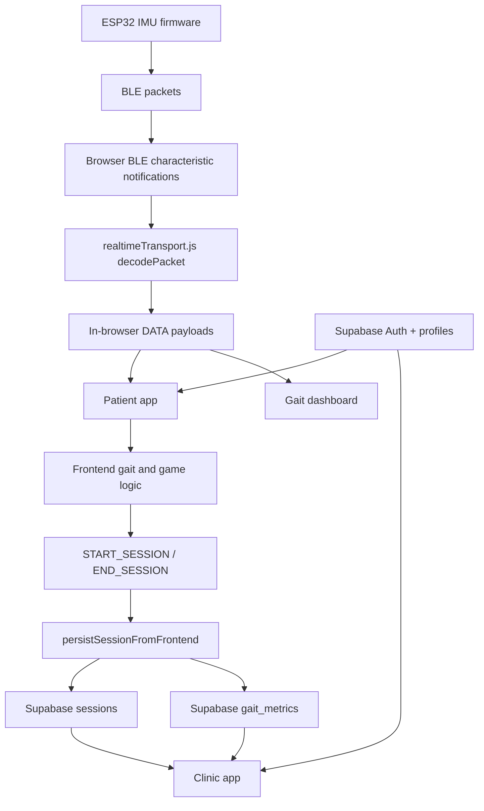

# System Overview

อัปเดตตามโค้ดใน repository นี้ ณ วันที่ 2026-05-04

## 1. DernDee คืออะไร

DernDee เป็นระบบกายภาพบำบัดการเดินแบบ realtime ที่เชื่อม 4 ชั้นเข้าด้วยกัน:

1. wearable IMU firmware บน ESP32
2. Browser BLE realtime transport ใน frontend
3. React web apps สำหรับ patient และ clinic
4. Supabase สำหรับ auth, profiles, session history, และ review workflow

เป้าหมายหลักของระบบคือให้ผู้ป่วยฝึกเดินหรือเล่นเกมกายภาพจากข้อมูลเซนเซอร์จริง, ให้ frontend คำนวณ game/gait logic จาก raw stream, และให้ clinician ดูผลย้อนหลังในระดับ session ได้จากฐานข้อมูลกลาง

## 2. องค์ประกอบหลักของระบบ

### Frontend

- path หลัก: `DernDee_Web-app/`
- framework: React 18 + Vite 4 + React Router 6
- split เป็น 3 entry points
  - patient app
  - clinic app
  - gait dashboard
- shared layer อยู่ที่ `DernDee_Web-app/shared/`

### Realtime Transport

- path หลัก: `DernDee_Web-app/shared/gateway/realtimeTransport.js`
- ภาษา: JavaScript
- ทำหน้าที่:
  - pair BLE devices ที่ขึ้นต้นด้วย `DernDee`
  - decode packet จาก IMU ใน browser
  - broadcast raw realtime `DATA` payloads ไปทุก route ที่เปิด `createRealtimeConnection()`
  - handle calibration และ session control messages แบบ in-browser
  - keep device assignments ไว้ข้าม route ใน session เดียวกัน

### Data Layer

- auth และ browser-side queries ใช้ Supabase JS client
- session persistence ใช้ frontend insert path ใน `shared/services/sessionService.js`
- schema ปัจจุบันรองรับ profiles, patient presence, sessions, gait metrics, doctor assignments, และ review state

### Firmware

- path หลัก: `Hardware/`
- runtime ปัจจุบันเข้ากันได้กับ packet format ของ `Hardware/esp32_imu_node.ino`
- firmware รุ่นอื่นในโฟลเดอร์นี้ควรมองเป็น reference/prototype จนกว่าจะยืนยัน packet compatibility อีกครั้ง

## 3. โครงสร้าง repo ที่ใช้งานจริง

```text
DernDee_Robustness/
|-- README.md
|-- docs/
|   |-- README.md
|   |-- system-overview.md
|   |-- frontend-apps.md
|   |-- realtime-browser-ble.md
|   `-- supabase-cloud-data-layer.md
|-- DernDee_Web-app/
|   |-- apps/
|   |   |-- patient/
|   |   `-- clinic/
|   |-- shared/
|   `-- public/
|-- Hardware/
`-- supabase/
    `-- migrations/
```

## 4. Runtime Flow หลัก

### 4.1 Auth และ profile bootstrap

1. ผู้ใช้ login ผ่าน Supabase Auth
2. `UserAuthContext` sync auth state
3. `profileService` สร้างหรือ update row ใน `profiles`
4. patient browser ส่ง heartbeat ไป `patient_presence` ทุก 30 วินาทีเมื่อ online

### 4.2 Device connection และ calibration

1. patient เข้า `/device-connection`
2. pair sensors ผ่าน Web Bluetooth
3. transport เก็บ device assignments ไว้ใน browser session
4. patient เข้า `/calibration`
5. frontend ส่ง `CALIBRATE` ผ่าน in-browser transport
6. transport broadcast `CALIBRATION_START` และ `CALIBRATION_DONE`
7. frontend จึงอนุญาตให้เริ่ม therapy target ต่อไป

### 4.3 Free Walk session

1. `WalkSession.jsx` ส่ง `START_SESSION` พร้อม `patient_id` และ `session_type = free_walk`
2. transport เปิด active session metadata ใน memory
3. ระหว่างเดิน transport ส่ง `DATA` payloads แบบ raw realtime ไป browser routes ทั้งหมดที่ subscribe อยู่
4. frontend คำนวณ gait metrics และ feedback จาก raw stream
5. เมื่อจบ session frontend ส่ง `END_SESSION` พร้อม summary overrides
6. `persistSessionFromFrontend()` insert `sessions` row และ `gait_metrics` ลง Supabase

### 4.4 Gamification sessions

1. High Stepper, Magic Plate, และ Rhythm Drummer ใช้ realtime stream เดียวกับ Free Walk
2. แต่ละเกมส่ง `START_SESSION` และ `END_SESSION` ผ่าน shared hook เดียวกัน
3. เกมแต่ละตัวส่ง `details` เฉพาะเกม เช่น rep counts, zone time, target BPM, score
4. frontend persist `sessions` summary และ `sessions.details`
5. game modes ไม่ insert `gait_metrics` รายก้าว

### 4.5 Clinic review flow

1. doctor login ผ่าน Supabase account ที่ role เป็น `doctor`
2. clinic app query ผู้ป่วยที่ถูก assign ผ่าน `doctor_patient_assignments`
3. doctor เปิด patient detail เพื่อดูรายการ session
4. doctor เปิด analysis review ราย session เพื่อเขียน review status และ notes
5. review status ถูก update กลับไปที่ `sessions`

## 5. Data Flow ระดับสูง



## 6. สิ่งที่ persist กับสิ่งที่ไม่ persist

### Persist แน่นอน

- `profiles`
- `doctor_patient_assignments`
- `patient_presence`
- `sessions`
- `gait_metrics` สำหรับ `free_walk`
- `sessions.details` สำหรับ game-specific summaries

### ไม่ persist ลง Supabase แบบ 100 Hz

- raw IMU samples จาก firmware
- realtime `DATA` ทุก frame
- derived orientation หรือ game state ทุก sample ที่ frontend คำนวณเอง

### Summary-only game sessions

session types ต่อไปนี้เก็บเฉพาะ summary:

- `high_stepper`
- `magic_plate`
- `rhythm_drummer`

ผลคือหน้า history และ clinic cards ยังแสดงผลได้จาก summary row แต่จะไม่มี per-step `gait_metrics` สำหรับ export หรือ analysis เชิงลึกแบบ Free Walk

## 7. Endpoints และ browser requirements

| Surface | Value | Notes |
| --- | --- | --- |
| patient app dev | `http://localhost:5174/` | served by Vite |
| clinic app dev | `http://localhost:5174/clinic` | same Vite workspace |
| gait dashboard dev | `http://localhost:5174/gait-dashboard` | reuse Browser BLE transport จาก route กลาง |
| Supabase Auth redirect | env-driven | controlled by `VITE_SUPABASE_AUTH_REDIRECT_URL` |
| Browser requirement | Chromium/Bluefy with Web Bluetooth | required for live sensor mode |

## 8. ข้อจำกัดปัจจุบันที่ควรรู้

- realtime mode ต้องใช้ browser และ device ที่รองรับ Web Bluetooth จริง
- ถ้า browser ไม่รองรับ Web Bluetooth ระบบจะใช้ demo mode ได้ แต่ไม่สามารถอ่าน sensor จริงได้
- game sessions มี session summary ดีแล้ว แต่ analysis เชิงรายก้าวยังเน้นที่ Free Walk
- clinic app enforce role doctor ที่ frontend และ rely on Supabase RLS ฝั่ง data layer
- firmware compatibility ยังผูกกับ packet format ปัจจุบัน ไม่ใช่ทุก `.ino` ใน repo