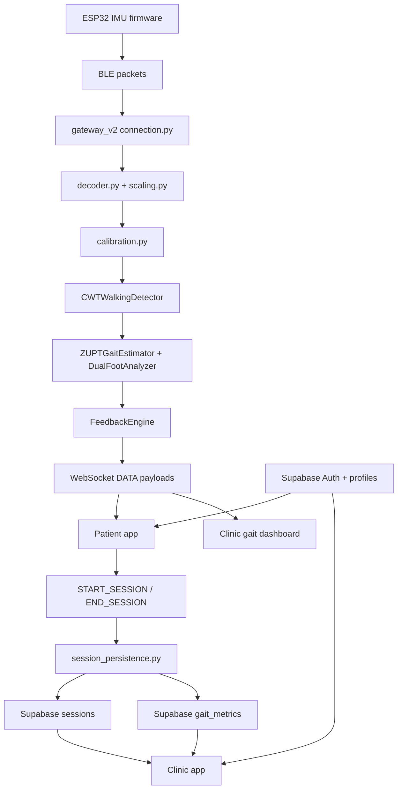

# System Overview

อัปเดตตามโค้ดใน repository นี้ ณ วันที่ 2026-05-01

## 1. DernDee คืออะไร

DernDee เป็นระบบกายภาพบำบัดการเดินแบบ realtime ที่เชื่อม 4 ชั้นเข้าด้วยกัน:

1. wearable IMU firmware บน ESP32
2. Python gateway สำหรับ BLE ingestion และ gait analysis
3. React web apps สำหรับ patient และ clinic
4. Supabase สำหรับ auth, profiles, session history, และ review workflow

เป้าหมายหลักของระบบคือให้ผู้ป่วยฝึกเดินหรือเล่นเกมกายภาพจากข้อมูลเซนเซอร์จริง, รับ feedback ระหว่าง session, และให้ clinician ดูผลย้อนหลังในระดับ session ได้จากฐานข้อมูลกลาง

## 2. องค์ประกอบหลักของระบบ

### Frontend

- path หลัก: `DernDee_Web-app/`
- framework: React 18 + Vite 4 + React Router 6
- split เป็น 3 entry points
  - patient app
  - clinic app
  - gait dashboard
- shared layer อยู่ที่ `DernDee_Web-app/shared/`

### Realtime Gateway

- path หลัก: `gateway_v2/`
- ภาษา: Python
- ทำหน้าที่:
  - scan/connect BLE devices ที่ขึ้นต้นด้วย `DernDee`
  - decode packet จาก IMU
  - calibration และ alignment
  - detect walking bouts
  - estimate gait metrics
  - broadcast realtime `DATA` payloads ไป frontend ผ่าน WebSocket
  - persist completed sessions ไป Supabase

### Data Layer

- auth และ browser-side queries ใช้ Supabase JS client
- gateway-side persistence ใช้ Supabase service role
- schema ปัจจุบันรองรับ profiles, patient presence, sessions, gait metrics, doctor assignments, และ review state

### Firmware

- path หลัก: `Hardware/`
- gateway ปัจจุบันเข้ากันได้กับ packet format ของ `Hardware/esp32_imu_node.ino`
- firmware รุ่นอื่นในโฟลเดอร์นี้ควรมองเป็น reference/prototype จนกว่าจะยืนยัน packet compatibility อีกครั้ง

## 3. โครงสร้าง repo ที่ใช้งานจริง

```text
DernDee_Robustness/
|-- README.md
|-- docs/
|   |-- README.md
|   |-- system-overview.md
|   |-- frontend-apps.md
|   |-- realtime-gateway.md
|   `-- supabase-cloud-data-layer.md
|-- DernDee_Web-app/
|   |-- apps/
|   |   |-- patient/
|   |   `-- clinic/
|   |-- shared/
|   `-- public/
|-- gateway_v2/
|-- Hardware/
`-- supabase/
    `-- migrations/
```

## 4. Runtime Flow หลัก

### 4.1 Auth และ profile bootstrap

1. ผู้ใช้ login ผ่าน Supabase Auth
2. `UserAuthContext` sync auth state
3. `profileService` สร้างหรือ update row ใน `profiles`
4. patient browser ส่ง heartbeat ไป `patient_presence` ทุก 30 วินาทีเมื่อ online

### 4.2 Calibration flow

1. patient เข้า `/calibration`
2. frontend เปิด WebSocket ไป `ws://<host>:8765`
3. frontend ส่ง `CALIBRATE`
4. gateway reset runtime state และเก็บ static samples
5. เมื่อ calibration สำเร็จ gateway ส่ง `CALIBRATION_DONE`
6. frontend จึงอนุญาตให้เริ่ม therapy target ต่อไป

### 4.3 Free Walk session

1. `WalkSession.jsx` ส่ง `START_SESSION` พร้อม `patient_id` และ `session_type = free_walk`
2. gateway เปิด active session ใน memory
3. ระหว่างเดิน gateway ส่ง `DATA` payloads แบบ realtime ไป browser
4. เมื่อจบ session frontend ส่ง `END_SESSION` พร้อม summary overrides
5. gateway persist `sessions` row และ `gait_metrics` รายก้าวลง Supabase

### 4.4 Gamification sessions

1. High Stepper, Magic Plate, และ Rhythm Drummer ใช้ WebSocket stream เดียวกับ Free Walk
2. แต่ละเกมส่ง `START_SESSION`/`END_SESSION` ผ่าน shared hook เดียวกัน
3. เกมแต่ละตัวส่ง `details` เฉพาะเกม เช่น rep counts, zone time, target BPM, score
4. gateway persist เฉพาะ `sessions` summary และ `sessions.details`
5. gateway ไม่ insert `gait_metrics` รายก้าวสำหรับ 3 session types นี้ เพื่อคุม Supabase quota

### 4.5 Clinic review flow

1. doctor login ผ่าน Supabase account ที่ role เป็น `doctor`
2. clinic app query ผู้ป่วยที่ถูก assign ผ่าน `doctor_patient_assignments`
3. doctor เปิด patient detail เพื่อดูรายการ session
4. doctor เปิด analysis review ราย session เพื่อเขียน review status และ notes
5. review status ถูก update กลับไปที่ `sessions`

## 5. Data Flow ระดับสูง



## 6. สิ่งที่ persist กับสิ่งที่ไม่ persist

### Persist แน่นอน

- `profiles`
- `doctor_patient_assignments`
- `patient_presence`
- `sessions`
- `gait_metrics` สำหรับ `free_walk`
- `sessions.details` สำหรับ game-specific summaries

### ไม่ persist ลง Supabase แบบ 100 Hz

- raw IMU samples จาก firmware
- realtime WebSocket `DATA` ทุก frame
- quaternion/position stream ทุก sample

### Summary-only game sessions

session types ต่อไปนี้เก็บเฉพาะ summary:

- `high_stepper`
- `magic_plate`
- `rhythm_drummer`

ผลคือหน้า history/clinic cards ยังแสดงผลได้จาก summary row แต่จะไม่มี per-step `gait_metrics` สำหรับ export หรือ analysis เชิงลึกแบบ Free Walk

## 7. Ports และ endpoints สำคัญ

| Surface | Value | Notes |
| --- | --- | --- |
| patient app dev | `http://localhost:5174/` | served by Vite |
| clinic app dev | `http://localhost:5174/clinic` | same Vite workspace |
| gait dashboard dev | `http://localhost:5174/clinic/gait-dashboard` | second clinic entry |
| gateway WebSocket | `ws://<host>:8765` | realtime data + control messages |
| Supabase Auth redirect | env-driven | controlled by `VITE_SUPABASE_AUTH_REDIRECT_URL` |

## 8. ข้อจำกัดปัจจุบันที่ควรรู้

- ระบบ realtime ยังต้องพึ่ง `gateway_v2` อยู่ ดังนั้น deployment แบบ Vercel อย่างเดียวไม่ครอบคลุม BLE + gait processing
- `DeviceConnection.jsx` ยังเป็น simulated UI ไม่ใช่ Web Bluetooth production flow
- game sessions มี session summary ดีแล้ว แต่ analysis เชิงรายก้าวจะต้องใช้ Free Walk หรือออกแบบ summary-based review ใหม่
- clinic app enforce role doctor ที่ frontend และ rely on Supabase RLS ฝั่ง data layer
- firmware compatibility ยังผูกกับ packet format ปัจจุบัน ไม่ใช่ทุก `.ino` ใน repo